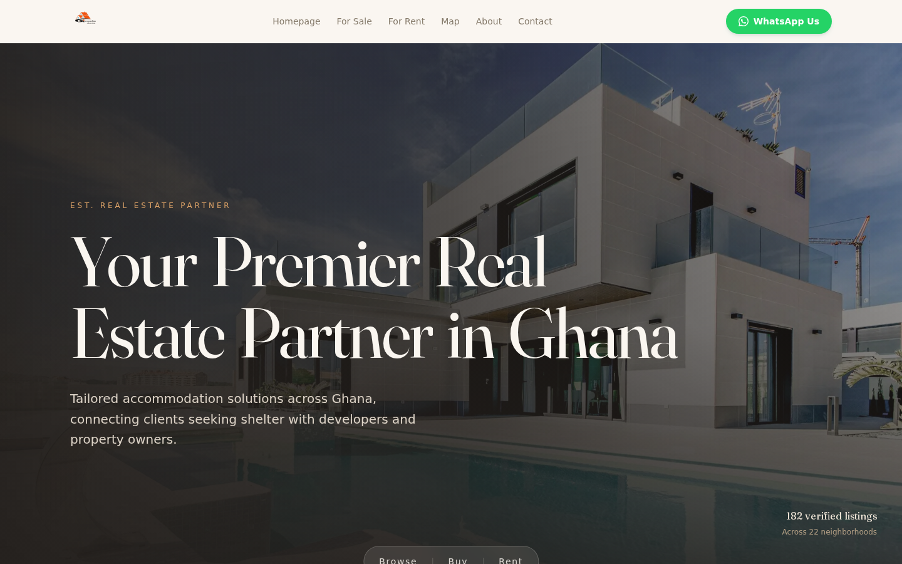
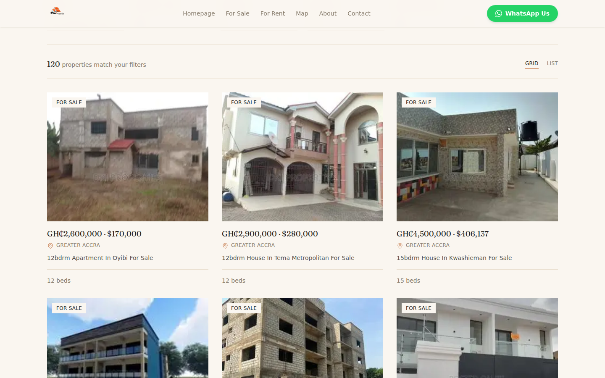
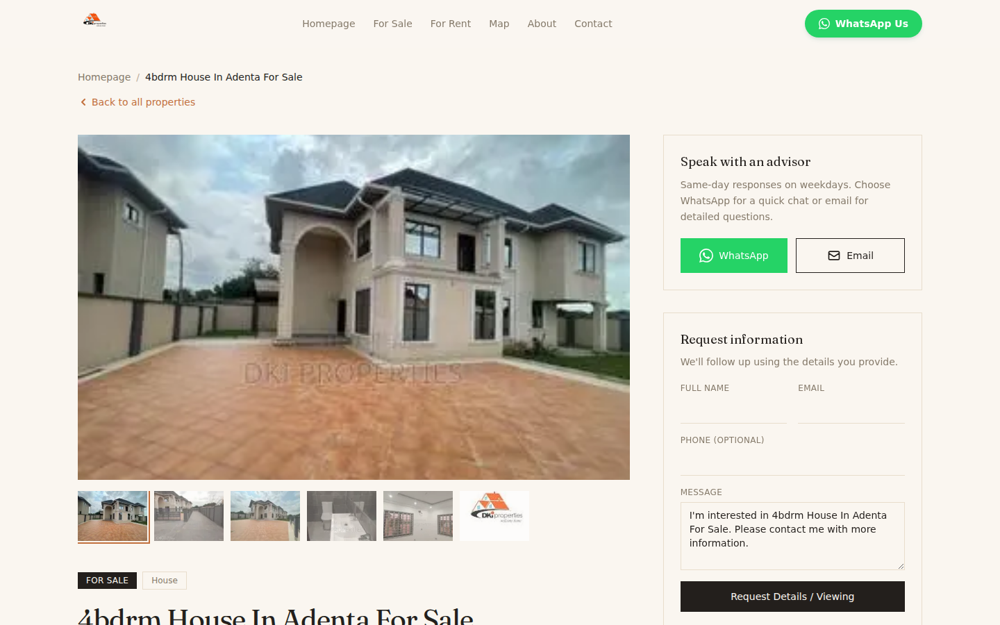
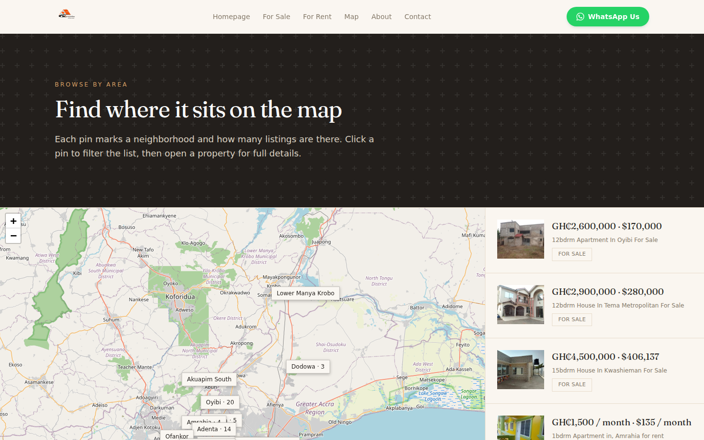
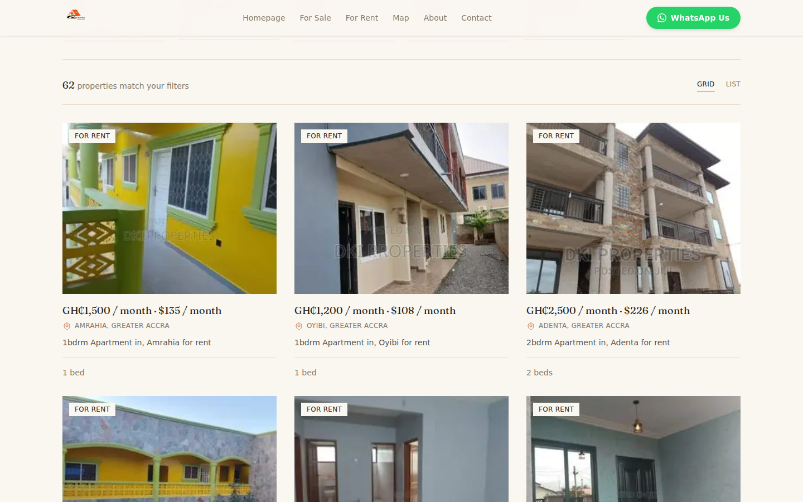
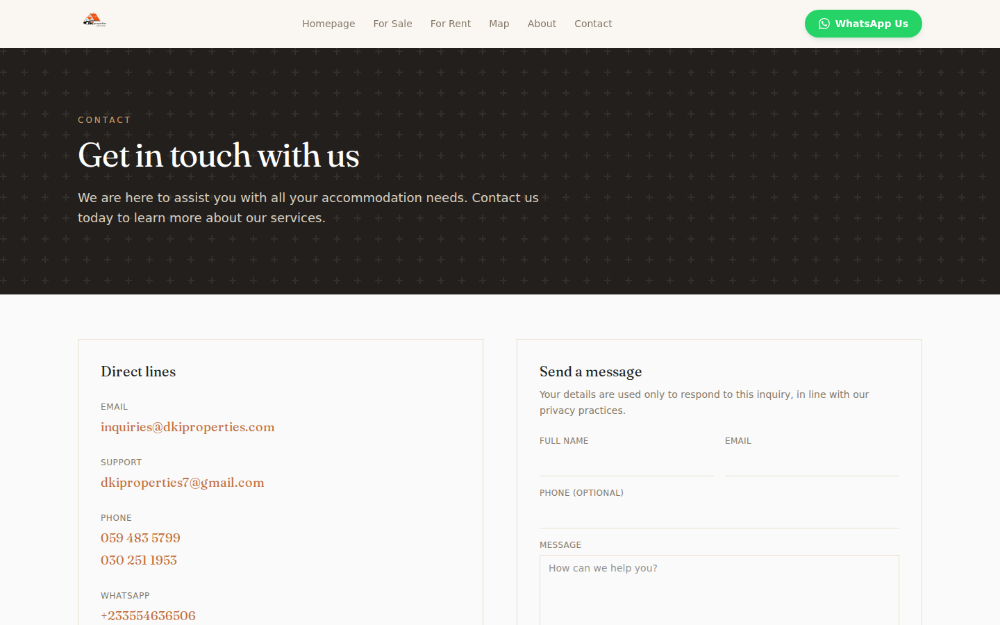
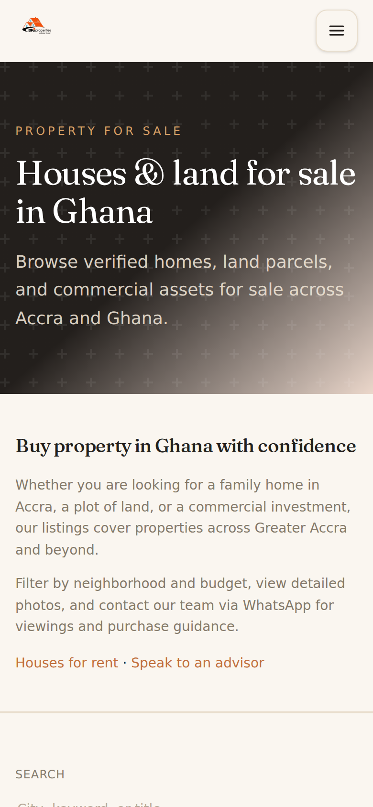
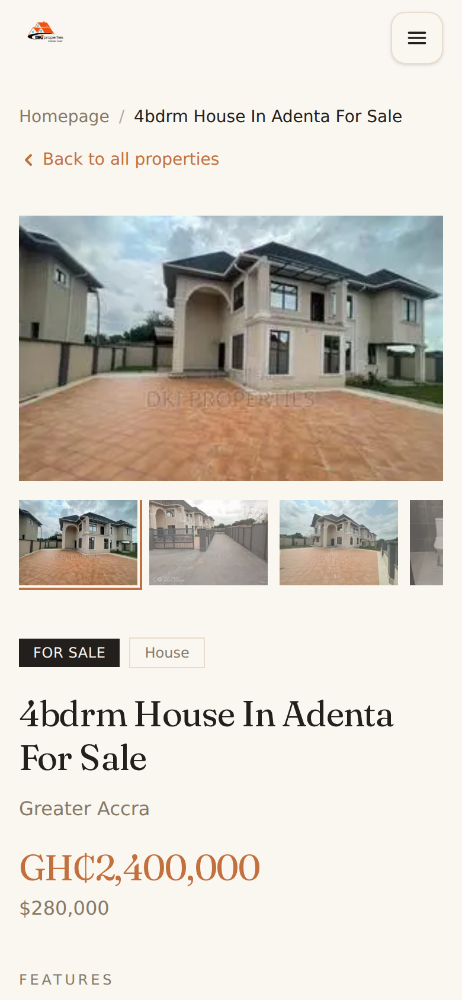
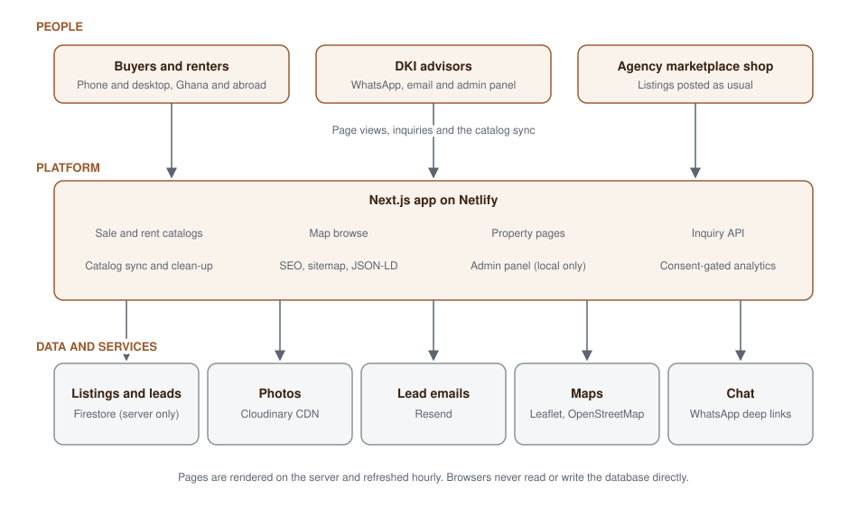

# DKI Properties

**A property platform I designed and built for a real estate agency in Ghana. Buyers and renters can browse verified homes, land and commercial property, compare them on a map, and reach an advisor on WhatsApp in one tap.**

[Live site](https://dkiproperties.netlify.app) · [Demo video](assets/demo/dki-properties-demo.mp4) · [Engineering highlights](#engineering-highlights) · [How it works](#how-it-works) · [Contact](#contact)

> This is a portfolio showcase of my work. The source code is private, and nothing here is open for reuse. See [All Rights Reserved](#all-rights-reserved).

## At a glance

| | |
| --- | --- |
| **What I built** | A server-rendered property website, a catalog sync pipeline, an inquiry backend and an admin panel |
| **My role** | Design, front end, data pipeline, backend, SEO, testing and deployment |
| **Stack** | Next.js 16 · React 19 · TypeScript · Tailwind CSS 4 · Firestore · Cloudinary · Resend · Netlify |
| **Quality** | Vitest unit tests, Playwright end-to-end and mobile layout tests, lint and build in GitHub Actions |
| **Status** | Live in production with 182 listings across 22 neighbourhoods (November 2026) |

## The problem

Finding a home or a plot of land in Ghana is slow and risky.

- **Listings are scattered** across classifieds sites, WhatsApp groups and Facebook posts. The same property appears several times with different prices and titles.
- **The information is unreliable.** A post titled "house" turns out to be a plot of land, and prices are quoted in cedis in one place and dollars in another.
- **Trust is low.** Buyers, especially Ghanaians buying from abroad, can't easily tell which listings are real, current and handled by an accountable agency.
- **Reaching an agent is slow.** Most people in Ghana prefer WhatsApp, but listing sites push them into email forms.

## The solution

DKI Properties is the agency's own storefront. It turns a messy marketplace catalog into clean, searchable listings that people can trust.

1. **One source of truth.** The agency keeps posting on its marketplace shop. A sync job pulls those listings, removes duplicates, fixes property types and re-hosts the photos, so the site always matches what is really available.
2. **Built for how Ghana buys.** Prices in GH₵ and USD, browsing by neighbourhood on a real map, and a WhatsApp message pre-filled with the listing name and link.
3. **No lost leads.** Every inquiry is stored and emailed to the team.
4. **Found on Google.** Every listing is a server-rendered page with structured data.

## Features

| For buyers and renters | For the agency | Under the hood |
| --- | --- | --- |
| Separate sale and rent catalogs | Listings synced from the marketplace shop | Duplicate and property-type clean-up |
| Filters for type, area, price, new and featured | Inquiries stored and emailed | Photos re-hosted on a CDN |
| Map with a pin per neighbourhood | Local-only admin panel for listings and inquiries | Hourly page regeneration |
| Photo gallery, key stats and location map | Consent-gated analytics | Sitemap and JSON-LD on every listing |
| One-tap WhatsApp to an advisor | Dual-currency pricing | Fallback catalog if the database is down |

## Screenshots

| Home | Sale catalog |
| --- | --- |
|  |  |

| Property detail | Map browse |
| --- | --- |
|  |  |

| Rent catalog | Contact |
| --- | --- |
|  |  |

| Mobile home | Mobile catalog | Mobile listing |
| --- | --- | --- |
|  |  |  |

Captured from the live website in November 2026, on desktop and at phone width.

## Demo video

▶ **[Watch the 18-second walkthrough](assets/demo/dki-properties-demo.mp4)** (MP4, plays in the browser on GitHub): home page, sale catalog, property detail and map browse.

## How it works

1. **Ingest.** A sync job reads the agency's marketplace shop, removes duplicates, corrects property types and moves photos to Cloudinary.
2. **Store.** Clean listings live in Firestore. Only the server can read or write it.
3. **Serve.** Next.js renders every page on the server and regenerates it hourly, so pages are fast, cacheable and indexable. If Firestore is unavailable, the site falls back to the last synced catalog.
4. **Convert.** Visitors reach an advisor through WhatsApp or a form. Form submissions are checked, stored and emailed to the team.
5. **Learn.** With the visitor's consent, Firebase Analytics shows which areas and listings attract interest.

## Engineering highlights

- **Data quality as a pipeline.** Marketplace posts are often mislabelled. I wrote audit and fix scripts that flag and correct wrong property types (a "house" that is really land) and duplicates, so buyers see accurate listings.
- **A database the browser can't touch.** Firestore is read and written only through the Firebase Admin SDK on the server, so no database credentials or rules are exposed to visitors.
- **Forms that resist abuse.** The inquiry and contact endpoints check the request origin, rate-limit by client IP and validate every field before anything is stored or emailed.
- **Resilient pages.** Listing pages regenerate hourly, and if Firestore is unreachable the site serves the last synced catalog instead of an error.
- **Search-ready.** Every listing has its own metadata, breadcrumb and catalog structured data, plus a dynamic sitemap.
- **Privacy by default.** Analytics only load after the visitor accepts cookies.
- **Locked-down admin.** The admin panel is password protected with JWT sessions and refuses to run in production, so the public site has no admin surface. The live site also sends strict security headers and a content security policy.
- **Tested on phones.** Playwright tests load the key pages at phone width and fail if anything scrolls sideways.

## Tech stack

| Area | Technology |
| --- | --- |
| Framework | Next.js 16 (App Router, Server Components, ISR), React 19, TypeScript |
| Styling and motion | Tailwind CSS 4, GSAP |
| Database | Firebase Firestore through the Admin SDK (server only) |
| Analytics | Firebase Analytics, behind cookie consent |
| Media | Cloudinary |
| Maps | Leaflet, OpenStreetMap |
| Email | Resend |
| Admin sign-in | JWT sessions with jose, rate-limited login |
| Data pipeline | Node and TypeScript scripts for sync, clean-up and seeding |
| Testing and CI | Vitest, Testing Library, Playwright, ESLint, GitHub Actions |
| Hosting | Netlify, with deploy previews for every pull request |

## The market

The site serves families and professionals renting or buying in Greater Accra and nearby areas, such as East Legon, Cantonments, Airport Residential, Adenta, Oyibi and Tema. It also serves Ghanaians abroad buying land or a home, and investors looking for commercial property.

Most agencies still rely on classifieds and social media posts. A searchable, WhatsApp-first agency site with consistent data sets DKI apart, and lowers the cost of each lead.

## Traction

- Live in production at [dkiproperties.netlify.app](https://dkiproperties.netlify.app).
- 182 listings across 22 neighbourhoods in November 2026: 120 for sale and 62 for rent. The count changes as the shop syncs.
- Visitor and inquiry numbers are not published.

## Try it

- **Live site:** [dkiproperties.netlify.app](https://dkiproperties.netlify.app)
- **Demo video:** [assets/demo/dki-properties-demo.mp4](assets/demo/dki-properties-demo.mp4)

## Contact

Interested in working together or seeing more of my work?

- **Email:** [7kbytesgh@gmail.com](mailto:7kbytesgh@gmail.com)
- **Portfolio:** [portfolio-eta-ivory-yshi67xev0.vercel.app](https://portfolio-eta-ivory-yshi67xev0.vercel.app)
- **GitHub:** [@7kbytes](https://github.com/7kbytes)

**More of my work**

- [Prime Expert Cargo](https://github.com/7kbytes/primecargo-showcase): a logistics platform for UAE to Ghana shipping (Flutter, Next.js, React, Node.js, PostgreSQL)
- [Prime Rental](https://github.com/7kbytes/prime-rental-showcase): car rental with Mobile Money payments and live GPS tracking (Next.js, PostgreSQL)
- [Primahk](https://github.com/7kbytes/primahk-showcase): a classifieds marketplace for Ghana (Next.js, React Native, NestJS, PostgreSQL)
- [SCC Small Poles League](https://github.com/7kbytes/sccsmallpolesleague-showcase): a grassroots football league platform (JavaScript, Supabase, Vercel)
- [Gomer Agency](https://github.com/7kbytes/gomer-showcase): a scholarship admissions portal for studying in China (Next.js, Firebase)
- [MedLink](https://github.com/7kbytes/medlink-showcase): a prescription marketplace app for patients and pharmacies (Flutter, Supabase)
- [Maestro Sports](https://github.com/7kbytes/maestrosports-showcase): a production website for a football management company (Next.js)

## All Rights Reserved

© 2026 7Kbytes. All Rights Reserved. Nothing in this repository may be copied, modified, distributed or reused without prior written permission. The DKI Properties name, logo and listing photography belong to their owners and are shown for presentation only. See [LICENSE](LICENSE).
